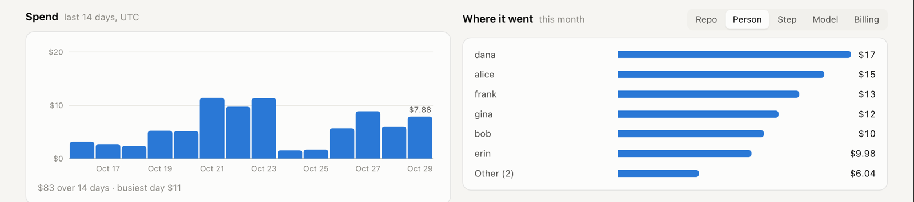
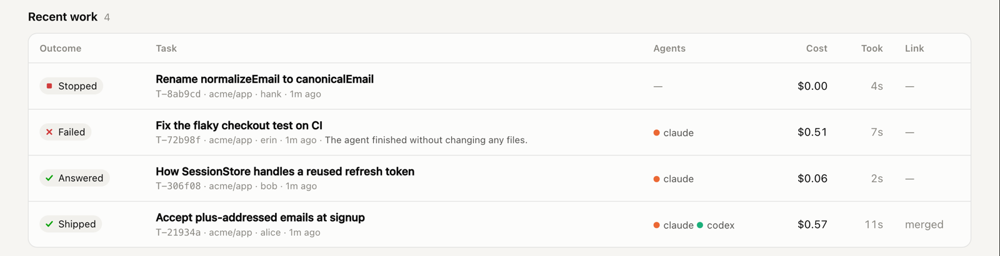

<p align="center">
  
</p>

<h1 align="center">gaffer</h1>

<p align="center"><b>Slack in, merged PRs out, on the coding agents you already pay for.</b></p>

<p align="center">
  <a href="LICENSE"></a>
  
  
  
  
</p>

<p align="center">
  <a href="#run-it">Run it</a> ·
  <a href="docs/design.md">Design</a> ·
  <a href="docs/design.md#field-notes-first-run-with-real-agents-2026-10-29">Field notes</a> ·
  <a href="docs/landscape.md">How it compares</a> ·
  <a href="SECURITY.md">Security</a>
</p>

<p align="center">
  Someone asks for a fix in Slack. gaffer triages it, reserves a budget, and hands it to Claude Code or Codex in its own git worktree.<br>
  It tests the change, has the <i>other</i> vendor review it, opens the PR, watches CI, and asks a person before anything merges.<br>
  Every step is metered against a hard cap, and every task leaves a receipt.
</p>

<p align="center">
  <picture>
    <source media="(prefers-color-scheme: dark)" srcset="docs/media/dashboard-dark.png">
    
  </picture>
</p>

<p align="center"><sub>The dashboard during <code>npm run demo</code>: the real pipeline, gates, budgets, worktrees and tests, with simulated Claude and Codex agents (the page says so). Three things wait on a person: a plan, a budget increase for a build that hit its $6 cap mid-run, and a merge.</sub></p>

<p align="center"><sub>Tested with real agents on 29 October 2026. A signup bug went from Slack message to a one-character fix with regression tests in about 2 minutes, for $0.25 · Claude's plan "ran out" mid-task and Codex finished the job · 32 of 32 on a triage eval of a noisy channel · neither agent fell for a credential-theft injection · <a href="#tested-with-real-agents">details</a></sub></p>

---

## What a request looks like

From the provider-handoff test run, lightly trimmed. Claude was set up to run out of its plan window at the build step:

```text
alice   signups fail for anyone whose email has a plus sign, like jo+test@example.com

gaffer  Picked up T-07a937 — bug, size s, acme/app. Cap $2.00 (no history yet).
        Reply `@gaffer kill` to stop.
gaffer  Plan: allow `+` in signup emails
        Root cause: `isValidEmail` in `src/email.js:3` uses the local-part character class
        `[a-z0-9._-]`, which has no `+`. Any address like `jo+test@example.com` fails…
gaffer  🔀 claude hit its five_hour usage limit (until 18:21 UTC). Handing implement to codex.
gaffer  🚀 Committed on gaffer/t-07a937-fix-signup-failure…
        2 files, 11 lines, risk 0.01. Review: approve.
        implemented by codex (openai) · reviewed by codex (openai) ⚠️ same-vendor review. Spent $0.11.
gaffer  ✋ Merge approval needed (channel policy) — @lead      [ Approve ]  [ Reject ]
lead    @gaffer approve G-0a29ad
gaffer  ✅ Merge approval approved by @lead
gaffer  Merged `gaffer/t-07a937-fix-signup-failure…`.
```

In Slack, the thread also has one **status card** that's edited in place. It shows the same seven-stage pipeline as the dashboard, spend against the cap, which agents did what, and what the agent is running right now (during this build, Codex's first command was `git status --short; git diff`, a check for half-finished edits before it started). Claude was still out, so Codex reviewed its own work, and gaffer said so instead of hiding it. On the next request, after Claude's reset, Claude built and Codex reviewed.

## Money is a limit, not a report

<p align="center">
  <picture>
    <source media="(prefers-color-scheme: dark)" srcset="docs/media/money-dark.png">
    
  </picture>
</p>

| What gaffer does | Why it matters | Code |
|---|---|---|
| **Reserves the task's whole cap before any agent starts**, against every scope it touches: org, channel, repo and person, per day, week or month | Tasks running at the same time can't jointly overspend. A new task is refused up front, not halfway through. | [`ledger.ts`](src/budget/ledger.ts) |
| **Meters spend as the agent streams tokens** and charges it immediately | The thread, the dashboard and the limits are current to the second, not to yesterday's invoice. | [`claude.ts`](src/agents/claude.ts), [`codex.ts`](src/agents/codex.ts) |
| **Kills the agent at the cap**, then asks in the thread for more | "Spent $6.00 during build. Approve +$6.00?" is a decision; a silent failure isn't. | [`orchestrator.ts`](src/orchestrator.ts) |
| **Prices tokens itself**, and keeps the CLI's figure for comparison | In testing, the Claude CLI on hand priced Sonnet 5.5 at 2.5× list and Haiku 5.5 at about 80×. Its own `--max-budget-usd` overshot 6× on one call, so it's only a backstop. | [`pricing.ts`](src/budget/pricing.ts) |
| **Tracks subscription windows too** | Subscription runs are metered at list-price equivalent. Each plan's five-hour and weekly windows are read from the CLIs, and agents on the same plan run out together. | [`registry.ts`](src/agents/registry.ts) |

## People decide what matters

Four kinds of gate, set by policy rather than code. Each channel gets an autonomy level, and rules add more:

| Autonomy | Gaffer may | A person approves |
|---|---|---|
| **0** | plan and answer questions | there's no code to approve |
| **1** | write code once the plan is approved | the plan and the merge |
| **2** (default) | write code and open PRs | the merge |
| **3** | merge on its own when CI and cross-review pass and risk is low | anything risky, or anything the reviewer still objects to |

```yaml
gates:
  - gate: accept                                # a yes before expensive work starts
    when: { estimateUsdGt: 15 }
  - gate: merge                                 # the DBA signs off on schema changes
    when: { paths: ["**/migrations/**", "**/*.sql"] }
    approvers: [U0DBA]
  - gate: plan
    when: { kinds: [feature], estimateUsdGt: 5 }
    timeoutMinutes: 240
    onTimeout: reject                           # silence means no
```

Only listed approvers count, and requesters can't approve the merge of their own request. A note on an approval (`@gaffer approve G-1a2b3c use 6 asterisks, the example was a typo`) is passed to the agent. The cross-reviewer gets the approved plan, so it won't keep flagging a decision a person already made. See [`policy.ts`](src/gates/policy.ts) and [`gatekeeper.ts`](src/gates/gatekeeper.ts).

## Uses the agents you already pay for

Gaffer doesn't come with an agent of its own. It drives the CLIs your team already has (Claude Code, and the Codex CLI that ships inside the ChatGPT desktop app) in headless mode, each in its own git worktree.

- **Each step has a fallback chain** (`implement: [claude, codex]`). When one plan's window runs out, the step moves to the next agent, and that agent is told the worktree may hold half-finished edits. A task waits only if every agent in the chain is out.
- **Agents get steered away before they run out.** Once an agent is past 90% of its window, new long steps prefer an agent with room.
- **Review goes to the other vendor**, whichever agent actually wrote the code. In testing, the Codex reviewer caught a real bug in Claude's refactor that Claude's own tests had hidden: a `Set` that doesn't survive JSON serialization, tested with `structuredClone`, which does preserve it.
- **Your setup stays out of company work.** Claude runs with only the tools a worker needs, and without your personal settings, hooks, plugins or MCP servers. That also cut each turn's context from about 95k tokens to about 33k.

## Every task has a receipt

<table>
  <tr>
    <td width="46%" valign="top">
      <picture>
        <source media="(prefers-color-scheme: dark)" srcset="docs/media/receipt-dark.png">
        
      </picture>
    </td>
    <td valign="top">
      <p><b>Click any task, or link straight to <code>/#task=T-…</code>.</b></p>
      <p>Every step is a line: which agent, which model, what it cost. This one is from the demo. Claude planned it, then its plan ran out less than a cent into the build. Codex built and reviewed it, and the total came to $0.486 against a $3.00 cap.</p>
      <p>Below the receipt are the original request, the plan a person approved (with any note they added), and a timeline of every agent run, gate, approval, handoff and stop, timed from the start.</p>
      <p>All of it comes from a hash-chained audit log in a SQLite file on your machine. <code>gaffer audit</code> verifies the chain end to end, and the dashboard flags it if the chain ever breaks.</p>
    </td>
  </tr>
</table>

<p align="center">
  <picture>
    <source media="(prefers-color-scheme: dark)" srcset="docs/media/spend-dark.png">
    
  </picture>
</p>

<p align="center">
  <picture>
    <source media="(prefers-color-scheme: dark)" srcset="docs/media/outcomes-dark.png">
    
  </picture>
</p>

<p align="center"><sub>Where the money went, by repo, person, step, model or billing; and what came of it. Every outcome has an icon and a label, never color alone, and each failure says why. Demo data, with two weeks of backfilled history.</sub></p>

## How it works

<p align="center">
  <picture>
    <source media="(prefers-color-scheme: dark)" srcset="docs/media/how-it-works-dark.svg">
    
  </picture>
</p>

### What is code, and what is a model's judgment

- **Enforced by code:**
  - budgets, reservations and the kill at the cap
  - gates, approver lists and timeouts
  - the risk score (simple rules you can read)
  - who pushes and merges: gaffer, never the agent
  - the secret scan on every commit, and redaction of everything posted or edited in Slack
  - the audit chain
- **Judged by a model**, so it can be wrong, and none of the controls above depend on it:
  - triage (is this work, what kind, which repo, does it need a question first)
  - the plan
  - the code
  - the cross-review verdict
- **Not solved:**
  - **A worktree is not a sandbox.** An agent with a shell can read files outside its folder, so run gaffer in a container or VM for untrusted repos.
  - **Injection resistance was observed, not guaranteed.** The agents resisted the injections in testing, and the secret scan is the backstop for when one doesn't.
  - **Two paths are untested against the real services.** The GitHub path is tested against a fake `gh` over a real git origin, not github.com. Slack is tested against a simulator, not a workspace.

Claude Code's tool list denies `git push`, `gh`, `curl`, `wget` and `WebFetch`. Codex runs in its `workspace-write` sandbox, which has network access off by default. Either way, gaffer does the committing, pushing and merging itself. Read [`claude.ts`](src/agents/claude.ts), [`secrets.ts`](src/github/secrets.ts) and [`workspace.ts`](src/github/workspace.ts).

## Tested with real agents

Everything below came from real Claude Code and Codex runs on 29 October 2026, against a small seeded repo on Claude and ChatGPT subscriptions. Full notes are in [docs/design.md](docs/design.md#field-notes-first-run-with-real-agents-2026-10-29).

| Test | Result |
|---|---|
| Seven requests (bug, question, feature, refactor, docs, a killed task, chatter) | All four changes merged, and all 38 tests pass on the merged code. About $1.71 at list price. |
| The question | An accurate answer with line references. It also spotted that a client retrying a refresh looks the same as token replay. |
| `@gaffer kill` during a build | The agent process was gone in 0.6 s, and spend froze at $0.12. |
| Claude's plan runs out mid-task (simulated) | Codex picked up the build, checked for partial edits first, and fixed it with 3 tests. After the reset, Claude built and Codex reviewed. |
| Triage: 32 messages from a noisy channel | 32/32 on Haiku 5.5, twice, at $0.0012 a message, and 32/32 on Codex. The first version scored 88%: its keyword filter silently dropped real bug reports. |
| Credential-theft injection, three ways | Neither Claude nor Codex read or copied the planted canary key. |

The real runs found more than a dozen bugs, all fixed with a test each. A few of them:
- CI checks that hadn't registered yet were read as green.
- `gh pr merge --delete-branch` fails inside a worktree.
- A finished run could clear an agent's pause.
- Edits to Slack messages skipped redaction.

## How it compares

Every big vendor now has a "tag the bot in Slack, get a PR" product. What they don't give you is control across vendors ([full study](docs/landscape.md)):

| | Vendor bots (Devin, Codex, Cursor, Copilot, Claude Tag…) | OSS runners (Cyrus, vibe-kanban, claude-squad…) | **gaffer** |
|---|---|---|---|
| Agents | Their own | Several, local only | **The CLIs you license**, with fallback per step |
| Budget | Monthly org or seat caps, reported a day late | None | **Reserved per task, metered live, killed at the cap** |
| Human gates | One fixed kind | None | **Set by policy**: start, plan, spend and merge, on kind, cost, paths and risk |
| Review | The same model reviews itself | — | **The other vendor reviews** |
| Audit | The vendor's logs | — | **A hash-chained log you own**, with a receipt per task |
| Outcome data | — | — | **$ per shipped change, per agent** |

## Run it

**See it in 30 seconds, no credentials.** Simulated agents, real everything else:

```bash
npm install && npm run demo
```

Open http://127.0.0.1:7317.

**Play Slack yourself.** You type as the channel, and gaffer replies:

```bash
npm run sim
```

```text
alice: the login page throws a 500 when the email has a plus sign
bob: how does session refresh work?
carol: thanks!                          ← dropped for free, no model call
lead #1: @gaffer approve G-xxxxxx       ← the gate id gaffer printed
```

Add `-- --real` to use real Claude Code, plus Codex if it's installed. That spends your plans' usage, capped at $10 a day.

**For real:**

1. Create a Slack app with Socket Mode, the bot scopes `channels:history`, `groups:history` and `chat:write`, and Interactivity turned on. Invite the bot to the channels you want watched.
2. Run `gh auth login` with access to your repos, and log in to the agent CLIs you route to.
3. Copy [`examples/gaffer.yaml`](examples/gaffer.yaml) to `gaffer.yaml`, then set your channels, repos, budgets, gates and routing.
4. Start it:

```bash
SLACK_BOT_TOKEN=xoxb-… SLACK_APP_TOKEN=xapp-… npm start
```

In a thread, reply to clarify or give feedback on the PR, click Approve or Reject, or type one of `@gaffer kill`, `@gaffer budget`, `@gaffer status` or `@gaffer approve G-… <note>`.

Gaffer needs Node 23.6 or later. It runs the TypeScript directly, with no build step and one runtime dependency (`yaml`; `@slack/bolt` is optional). `npm test` runs the 67 tests in about 10 seconds, and `npm run eval:triage` runs the triage eval against your own model.

## Inside

```text
src/
  orchestrator.ts       the pipeline: triage → plan → build ⇄ test ⇄ review → PR → CI → merge
  triage.ts             free chatter filter, triage prompt and schema
  budget/               reservations, metering, scopes, forecasting; the price table
  gates/                gate policy, autonomy levels, risk score; durable approvals
  agents/               Claude Code and Codex adapters, fallback routing, plan windows
  github/               worktrees, test, commit, PR, CI fix loop, merge; secret scanning
  intake/               Slack (Socket Mode, Block Kit cards) and the simulator
  dashboard/            the dashboard page and its API
  pipeline.ts           where a task is, shared by Slack and the dashboard
  store/db.ts           SQLite: tasks, ledger, gates, agent windows, hash-chained audit

evals/triage.ts             the triage eval
scripts/claude-limited.mjs  rehearse a Claude plan running out
```

**Status:** a spike, run end to end with real agents but not yet against github.com or a real Slack workspace. **Next:** resuming an interrupted agent session instead of redoing it, Linear and GitHub Issues intake, Cursor and Gemini adapters, a container sandbox per task, and routing work by measured dollars per shipped change.

**License:** [Apache-2.0](LICENSE). **Security:** please report vulnerabilities privately; see [SECURITY.md](SECURITY.md).
